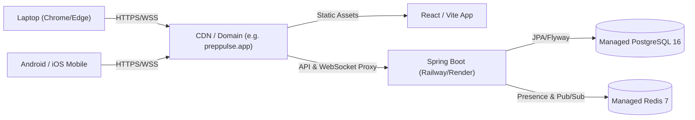

# PrepPulse — Production Cloud Deployment Guide

This guide describes how to deploy PrepPulse to cloud providers so users can connect from **any physical device anywhere in the world** across different networks via HTTPS and secure WebSockets (WSS).

---

## 1. Architecture Overview

In production:
- **Frontend**: Built as static assets (`npm run build`) and deployed to a global CDN (Vercel, Netlify, Cloudflare Pages, or AWS S3 + CloudFront).
- **Backend**: Spring Boot container packaged via Dockerfile, deployed to a container PaaS (Railway, Render, Fly.io, or AWS ECS / GCP Cloud Run).
- **Database**: Managed PostgreSQL 16 (Railway, Neon, Supabase, or AWS RDS).
- **Cache & Presence**: Managed Redis 7 (Upstash, Railway Redis, or Redis Cloud).
- **Security**: Managed SSL certificates terminate TLS at the reverse proxy/load balancer, providing HTTPS and WSS automatically.



---

## 2. Dockerfiles & Containerization

### Backend Dockerfile (`backend/Dockerfile`)
Ensure the multi-stage build is used for optimal image size:

```dockerfile
FROM eclipse-temurin:17-jdk-alpine AS build
WORKDIR /app
COPY pom.xml .
COPY src ./src
RUN apk add --no-cache maven && mvn clean package -DskipTests

FROM eclipse-temurin:17-jre-alpine
WORKDIR /app
COPY --from=build /app/target/chatapp-1.0.0-SNAPSHOT.jar app.jar
EXPOSE 8082
ENTRYPOINT ["java", "-jar", "app.jar"]
```

### Frontend Dockerfile (`frontend/Dockerfile`)
For container-based frontend hosting with Nginx:

```dockerfile
FROM node:18-alpine AS build
WORKDIR /app
COPY package*.json ./
RUN npm ci
COPY . .
RUN npm run build

FROM nginx:alpine
COPY --from=build /app/dist /usr/share/nginx/html
COPY nginx.conf /etc/nginx/conf.d/default.conf
EXPOSE 80
CMD ["nginx", "-g", "daemon off;"]
```

---

## 3. Environment Variables Configuration

### Backend Environment Variables

| Variable | Description | Production Example |
| :--- | :--- | :--- |
| `SERVER_PORT` | HTTP port | `8082` |
| `SERVER_ADDRESS` | Network bind address | `0.0.0.0` |
| `SPRING_DATASOURCE_URL` | PostgreSQL JDBC connection URL | `jdbc:postgresql://ep-xyz.postgres.database.azure.com:5432/preppulse?sslmode=require` |
| `SPRING_DATASOURCE_USERNAME` | PostgreSQL database user | `postgres` |
| `SPRING_DATASOURCE_PASSWORD` | PostgreSQL database password | *Strong generated secret* |
| `SPRING_DATA_REDIS_HOST` | Redis host | `redis-xyz.upstash.io` |
| `SPRING_DATA_REDIS_PORT` | Redis port | `6379` |
| `SPRING_DATA_REDIS_PASSWORD`| Redis authentication password | *Redis token/password* |
| `APP_JWT_SECRET` | 512-bit Base64 or 64+ char secret string | *Minimum 64-character random string* |
| `APP_CORS_ALLOWED_ORIGINS` | Trusted production frontend origins | `https://preppulse.vercel.app,https://yourdomain.com` |

> **IMPORTANT**: Never commit production passwords or JWT secrets to Git. Always configure them as secret environment variables in your hosting provider's dashboard.

### Frontend Environment Variables (`.env.production`)

```env
VITE_API_BASE_URL=https://api.yourdomain.com/api
VITE_WS_URL=https://api.yourdomain.com/ws
```
*(When using HTTPS, SockJS automatically upgrades WebSocket connections to `wss://`)*

---

## 4. Step-by-Step Cloud Deployment

### Option A: Railway.app (Recommended - Fastest Full-Stack Setup)

1. **Deploy PostgreSQL & Redis**:
   - In Railway, click **New Project** -> **Database** -> **Add PostgreSQL**.
   - Click **Add Service** -> **Database** -> **Add Redis**.
2. **Deploy Backend**:
   - Click **Add Service** -> **GitHub Repo** -> select the repository.
   - Set the Root Directory to `backend`.
   - In Variables, add:
     - `SPRING_DATASOURCE_URL`: `${{Postgres.DATABASE_URL}}`
     - `SPRING_DATA_REDIS_HOST`: `${{Redis.REDISHOST}}`
     - `SPRING_DATA_REDIS_PORT`: `${{Redis.REDISPORT}}`
     - `SPRING_DATA_REDIS_PASSWORD`: `${{Redis.REDISPASSWORD}}`
     - `APP_JWT_SECRET`: Generate a strong 64-character secret.
     - `APP_CORS_ALLOWED_ORIGIN_PATTERNS`: `https://*.vercel.app,https://*.railway.app`
   - Generate a Railway public domain (e.g., `preppulse-api.up.railway.app`).
3. **Deploy Frontend (Vercel)**:
   - Import repository into [Vercel](https://vercel.com).
   - Set Root Directory to `frontend`.
   - Add Environment Variable:
     - `VITE_API_BASE_URL`: `https://preppulse-api.up.railway.app/api`
     - `VITE_WS_URL`: `https://preppulse-api.up.railway.app/ws`
   - Deploy.

---

## 5. Production Health Check & Monitoring

- **Actuator Health Endpoint**: `GET https://your-backend-domain/actuator/health`
- **Database Migrations**: Flyway runs automatically on startup to ensure all tables, indexes, and initial seeds are migrated.
- **Log Hygiene**: Sensitive tokens and passwords are never logged to stdout.

